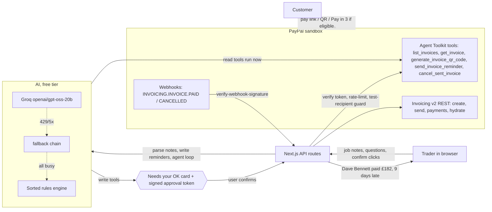

# Sorted

**Invoice sent, chased, sorted.**

Sorted is an AI agent for UK sole traders and tradespeople. You paste or say your messy job notes, for example *"fitted 2 radiators for Mrs Patel, 4 hrs, parts £86, she's at patel.r@example.com"*, and Sorted:

1. **Writes the invoice.** It turns the notes into a structured draft: customer, email, labour hours × your rate, parts, VAT (off by default for non-VAT-registered traders), GBP, and a due date 14 days out. You can edit everything before sending.
2. **Sends it through PayPal.** It uses the PayPal Invoicing API v2 to create and send the invoice. Your customer gets a secure link and can pay by card or PayPal.
3. **Keeps the ledger.** All your invoices sit in an AG Grid table with status badges, a days-overdue column, filters, quick search, a filtered totals row, CSV export and row actions.
4. **Chases late payers.** It spots overdue invoices and drafts reminders that get firmer each time: a friendly nudge, then a firm reminder, then a final notice. For business customers, the final notice cites the **Late Payment of Commercial Debts (Interest) Act 1998** and works out statutory interest and fixed compensation. Nothing is sent until you approve it.
5. **Answers "Ask Sorted" questions.** You can ask things in plain English, like *"Who owes me what?"*, *"How much did I earn in October?"* or *"Who's my latest payer?"*. A tool-calling agent answers from your ledger. It can also propose actions (create an invoice, send a reminder, mark something paid), and it always waits for your **explicit confirmation** first.

> UK businesses are owed an estimated **£26bn** in late payments at any given time, and **38 businesses close every day** because of late payment.
> Source: [Department for Business and Trade (2025), *Estimating the total economic cost of late payments*](https://assets.publishing.service.gov.uk/media/68652e8f6569be0acf74db3e/late-payments-infographic.pdf).

Built for the **PayPal AI Hackathon** (Devpost), entering Best Use of PayPal + AI, Best Use of Agentic Commerce, and the AG Grid prize.

**Judges, try it in 30 seconds:** open https://sorted-paypal.vercel.app/app, click an example note → **Draft invoice** → **Send**. The invoice opens with a **QR code** and **Preview what your customer sees**; pay it there and the row flips to **Paid** while Ask Sorted reports *"… paid £…, N days late"*. Then ask Ask Sorted *"Chase my worst payer"* and approve the card.

---

## Architecture at a glance



## What's live vs mocked

| Piece | Live (PayPal sandbox) | Demo mode |
|---|---|---|
| Create + send invoice | Real Invoicing v2 (REST), real PayPal payer page | Mock PayPal, nothing emailed |
| Ledger | Synced from PayPal (Agent Toolkit `list_invoices` + per-invoice GET), re-synced every minute | 21 seeded invoices in the browser |
| Ask Sorted PayPal tools | `@paypal/agent-toolkit` executes `list_invoices`, `get_invoice`, `generate_invoice_qr_code`; `send_invoice_reminder` / `cancel_sent_invoice` run after you confirm | Same tool names against mock PayPal |
| Approvals | HMAC-signed, 10-minute, single-use tokens verified by every write route | Same |
| Reminders | PayPal reminder email via the toolkit, with the payer-view pay link | Logged locally |
| QR code | PayPal's `generate-qr-code` via the toolkit | Locally drawn QR for the mock payer page |
| "Customer pays" | Real sandbox payer page; webhook (verified) + sync diff flip the row | Mock payer page `/pay/<id>` flips the row |
| Pay in 3 | Mentioned (hedged) for private customers owing £20–£3,000; PayPal decides eligibility on its page. Not verifiable in sandbox | Simulated button on the mock payer page |
| AI | Groq free tier (`openai/gpt-oss-20b`) with fallbacks; rules engine if all are busy | Same |

**Live by default:** when the server has sandbox keys (`PAYPAL_CLIENT_ID` / `PAYPAL_CLIENT_SECRET`), the app opens on the live sandbox for everyone, no keys to paste. On those shared keys, live writes are rate-limited (12 per IP per 10 min, 150 per instance per hour) and invoices can only be addressed to test mailboxes (`@example.com`, `.example`, `.test`, or `SORTED_ALLOWED_RECIPIENT_DOMAINS`). Pasting your own sandbox keys lifts the address rule. `npm run seed:sandbox -- --reset` restores the demo ledger in the sandbox after a demo.

## How PayPal is used

| Feature | PayPal API | Where |
|---|---|---|
| OAuth | `POST /v1/oauth2/token` (client_credentials, cached until near expiry, one automatic refresh on 401) | `src/lib/paypal/client.ts` |
| Invoice numbers | `POST /v2/invoicing/generate-next-invoice-number` | `client.ts` |
| Create invoice | `POST /v2/invoicing/invoices` (with `Prefer: return=representation` and a `PayPal-Request-Id` idempotency key) | `client.ts`, `mapping.ts` |
| Send invoice | `POST /v2/invoicing/invoices/{id}/send` | `client.ts` |
| Sync ledger | `GET /v2/invoicing/invoices` (paginated), `GET /v2/invoicing/invoices/{id}` | `client.ts` |
| Reminders | `send_invoice_reminder` tool from **PayPal Agent Toolkit** (falls back to `POST /v2/invoicing/invoices/{id}/remind`) | `src/lib/paypal/toolkit.ts`, `backend.ts` |
| Ask Sorted's ledger (live mode) | `list_invoices` tool from **PayPal Agent Toolkit** (falls back to REST) | `src/app/api/chat/route.ts` |
| Mark paid (cash / bank transfer) | `POST /v2/invoicing/invoices/{id}/payments` | `client.ts` |
| Cancel invoice | `cancel_sent_invoice` tool from **PayPal Agent Toolkit** (falls back to `POST /v2/invoicing/invoices/{id}/cancel`) | `backend.ts`, `api/invoices/[id]/cancel` |
| QR code to pay | `generate_invoice_qr_code` tool from **PayPal Agent Toolkit** | `api/invoices/[id]/qr`, `ai/agent.ts` |
| Ask Sorted's PayPal tools | Agent Toolkit `list_invoices`, `get_invoice`, `generate_invoice_qr_code`, `send_invoice_reminder` (after approval) | `src/lib/ai/agent.ts` |
| Payment notifications | Webhook `INVOICING.INVOICE.PAID` / `.CANCELLED`, verified with `POST /v1/notifications/verify-webhook-signature` | `api/paypal/webhook`, `lib/paypal/webhook.ts` |

The client retries 429 and 5xx responses with backoff (honouring `Retry-After`) and retries network errors. It also turns PayPal error payloads into readable messages that include the `paypal-debug-id`.

### PayPal Agent Toolkit

[`@paypal/agent-toolkit`](https://www.npmjs.com/package/@paypal/agent-toolkit) (v1.11, AI SDK flavour) supplies the agent's PayPal tool layer in live mode. The model is given the toolkit's tools by name (`list_invoices`, `get_invoice`, `generate_invoice_qr_code`, `send_invoice_reminder`, `create_invoice`); reads execute through the toolkit immediately, writes come back as a "Needs your OK" card carrying a server-signed approval token, and the write route verifies it before calling the toolkit (`send_invoice_reminder`, `cancel_sent_invoice`). Schemas are compacted for free-tier token limits: the toolkit's own `create_invoice` schema is ~10 KB, so the model passes job notes and **invoice creation** uses our own REST client, because it needs things the toolkit tool doesn't expose: `Prefer: return=representation`, idempotency keys, retries, and UK/GBP payload shaping (a business vs private recipient, VAT as a per-line tax, a specific due date). The toolkit is loaded with a dynamic import and kept out of the bundle (`serverExternalPackages`). If it fails to load, Sorted falls back to direct REST and the tool trace shows which path ran.

## How AI is used

- **Note parsing** (`src/lib/ai/parse.ts`): an LLM returns structured JSON. Guard rails stop it inventing an email that isn't in the notes and fall back to the heuristic parser if the JSON doesn't make sense.
- **Reminder writing** (`src/lib/ai/remind.ts`): the tone depends on the stage. The model only gets verified facts (amounts, dates, pay link, statutory interest). A guard rail rejects any draft that cites the Late Payment Act for a private customer.
- **Ask Sorted agent** (`src/lib/ai/agent.ts`): a provider-agnostic tool-calling loop with these tools: `get_ledger_summary`, `get_earnings`, `rank_payers`, plus the PayPal Agent Toolkit tools `list_invoices`, `get_invoice`, `generate_invoice_qr_code`, `send_invoice_reminder`, `create_invoice`, and `propose_mark_paid`. Any tool that would contact a customer or change an invoice returns a **pending action** with a signed approval token. The UI shows it as a "Needs your OK" card; the write route rejects the request (403) unless the token matches that action and invoice, is under 10 minutes old and unused.
- **Providers** (`src/lib/ai/provider.ts`), free tiers first: **Groq** (`openai/gpt-oss-20b`, falling back to `qwen/qwen3.8-27b` on a 429), **NVIDIA NIM** (`nvidia/nemotron-3-super-120b-a12b`), **OpenRouter** (`nvidia/nemotron-3-super-120b-a12b:free`), then Google Gemini, OpenAI (or any OpenAI-compatible endpoint via `OPENAI_BASE_URL`) and Anthropic. Groq, NVIDIA, OpenRouter and OpenAI share one OpenAI-compatible chat-completions adapter with native tool calling; everything uses plain `fetch`. Every configured provider is tried in order and the next one is used on a 429, 5xx or timeout. A 429 parks that provider+model for a few minutes in memory, so requests stay fast while a free quota is exhausted. `SORTED_AI_PROVIDER` pins one provider.
- **Frugal by design**: one LLM call per note parse (identical notes are cached for 10 minutes), reminder drafts are one call, and Ask Sorted runs at most 3 tool-loop rounds. Tools never make nested LLM calls, and when the agent proposes an action ("Needs your OK") it answers without a second model call.
- **Deterministic fallback, always available**: a clause-based job-notes parser (handles "18 quid", "£1.2k", "call out 45", "vat on top" / "+ VAT" / "no vat", "x2", day rates, "net 30" / "pays in 14 days", Mr/Mrs/Ms names in any case, addresses), template reminders, and a rules-based agent that calls the same tools for the common questions. With no API key every feature still works. Each answer shows which engine produced it: "✦ Groq openai/gpt-oss-20b", "⚙ Sorted rules engine (no AI key)", or "⚙ Sorted rules engine (AI busy, fallback)" when a key exists but every provider is rate-limited or down.
- **What is sent to AI providers**: the job notes you type (including any customer name/email in them), or for reminders and Ask Sorted, invoice facts from your ledger (customer names, amounts, dates). No PayPal credentials are ever sent. Free tiers of some providers may use prompts to improve their models; leave the AI keys unset to keep everything on the rules engine.

## Modes

| Mode | When | What happens |
|---|---|---|
| **Demo** (badge in header) | No PayPal credentials, or the user picks "Use demo" | Mock PayPal backend with 21 seeded invoices for a Bristol plumbing & heating sole trader (paid / sent / overdue, private and business customers, reminder history). The ledger is kept in the browser's `localStorage`. Nothing is emailed. "Reset demo" restores the seed. |
| **Live (PayPal sandbox)** | The user pastes their own sandbox Client ID + Secret in **Connect PayPal sandbox**, *or* the server has `PAYPAL_CLIENT_ID`/`PAYPAL_CLIENT_SECRET` | PayPal is the source of truth. The ledger syncs from PayPal and invoices really go out (to sandbox emails). Reminder history is also kept locally, because PayPal's list API doesn't return it. |

**Browser-supplied credentials** are stored only in that browser's localStorage and sent over HTTPS on each request (`x-paypal-client-id` / `x-paypal-client-secret`). They are **pinned to `api-m.sandbox.paypal.com`**, so pasted keys can never move real money. The server doesn't store or log them, and token and toolkit caches are keyed by a fingerprint, never by the raw secret. Precedence is browser creds, then server env vars, then demo.

## Setup

```bash
npm install
cp .env.example .env.local   # everything is optional
npm run dev                  # http://localhost:3000
```

```bash
npm run lint && npm run typecheck && npm test && npm run build
npm start &                  # then, in another shell:
npm run smoke -- http://localhost:3000   # end-to-end API smoke test (demo mode)
```

### Environment variables

See [`.env.example`](.env.example). They are all optional:

- `PAYPAL_CLIENT_ID`, `PAYPAL_CLIENT_SECRET` (sandbox app keys: turn on live-by-default), `PAYPAL_ENV` (`sandbox` | `live`), `PAYPAL_API_BASE`, `SORTED_FORCE_DEMO`
- `PAYPAL_WEBHOOK_ID` (from `npm run webhook:register`), `SORTED_APPROVAL_SECRET` (HMAC key for approval tokens), `SORTED_ALLOWED_RECIPIENT_DOMAINS`, `SORTED_LIVE_WRITES_PER_IP`, `SORTED_LIVE_WRITES_PER_HOUR`, `NEXT_PUBLIC_SITE_URL`
- `GROQ_API_KEY` / `GROQ_MODEL` / `GROQ_FALLBACK_MODEL`, `NVIDIA_API_KEY` / `NVIDIA_MODEL`, `OPENROUTER_API_KEY` / `OPENROUTER_MODEL`, `GEMINI_API_KEY` / `GEMINI_MODEL`, `OPENAI_API_KEY` / `OPENAI_MODEL` / `OPENAI_BASE_URL`, `ANTHROPIC_API_KEY` / `ANTHROPIC_MODEL`, `SORTED_AI_PROVIDER`, `SORTED_AI_TIMEOUT_MS`, `SORTED_AI_BUDGET_MS`, `SORTED_AI_DISABLED`

### Scripts

- `npm test`: unit tests (parser, AI provider chain, PayPal mapping/client/toolkit, approvals, guards, webhook events, reminders)
- `npm run smoke -- <url>`: end-to-end checks against a running server (demo mode)
- `node scripts/live-e2e.mjs <url>`: live sandbox end-to-end (server with PayPal creds)
- `npm run seed:sandbox -- [--reset] [--fresh]`: seed/reset the sandbox demo ledger
- `npm run webhook:register -- [url]`: register the sandbox webhook and print `PAYPAL_WEBHOOK_ID`

Current verified status: [`docs/status.md`](docs/status.md).

### Deploy

Sorted is a standard Next.js 16 App Router app and deploys to Vercel with no configuration. It needs no database. Demo state lives in the browser, and live state lives in PayPal.

## Stack

Next.js 16 (App Router, TypeScript), Tailwind CSS v4, AG Grid Community 36 (`ag-grid-community` + `ag-grid-react`), PayPal Invoicing v2 REST, `@paypal/agent-toolkit`, the Web Speech API (`en-GB`) for dictation.

### AG Grid features used

Custom cell renderers (customer avatar with job summary, status badges, a days-overdue severity bar, reminder stage badges, row actions: Chase / Remind / Paid / PayPal ↗), a status-aware sort comparator, text/number/date column filters, an external filter driven by segmented status chips with live counts, a quick-filter search box, a **pinned bottom totals row that recalculates over the filtered rows**, overdue row classes, pinned columns, CSV export, and responsive column hiding on phones. It uses the `themeQuartz.withParams` theming API.

## AI tools used to build it

The code was written by the **Hark AI agent** (an autonomous coding agent), working from Olly McBride's product brief.

## Not legal advice

Sorted's reminder wording and statutory interest figures are there to help. Check the rules for your situation (gov.uk: *Late commercial payments: charging interest and debt recovery*).

## License

MIT © 2026 Olly McBride
